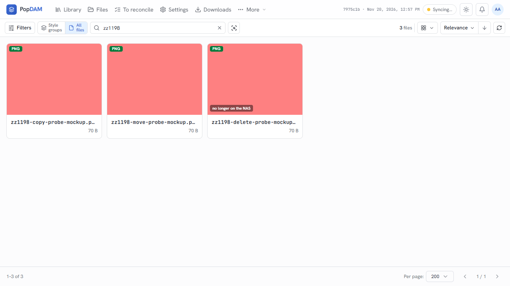
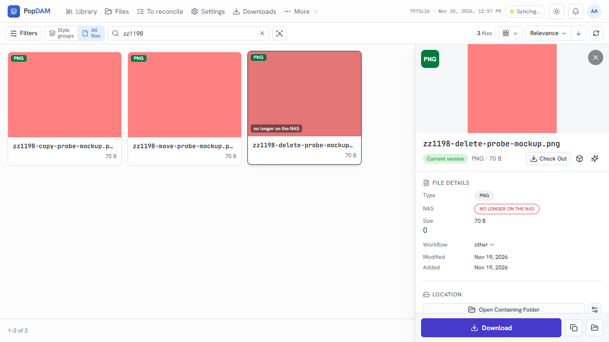

# "No longer on the NAS" mark — live proof (2026-11-20, EST)

Owner ruling (Albert, 2026-11-19, verbatim): "when artwork is gone from the NAS
it should be marked 'no longer on the NAS'". Shipped: column
`assets.file_missing_at` (popcre/shared-db#6896, production apply run
44782418802) + popdam3 PR #1247 (mark set/clear + badge + label).

## What was proven

Test fixtures on the NAS under `Decor/Generic Decor/ZZ-TEST-1198*/` (all named
`zz1198-*-mockup.png`, identical 70-byte PNGs):

1. **Mark** — `zz1198-delete-probe-mockup.png` deleted from disk; the scan of
   2:4x–3:28 PM EST kept its record (`cd201914-c3eb-4bf5-8883-150f3cf816a6`,
   `is_deleted: false`) and set `file_missing_at = 2026-11-20T13:28:21.021-05:00`.
   `badge-grid.png` — the library card carries the "no longer on the NAS" chip;
   the two records whose files exist show no chip. `badge-detail.png` — the
   asset detail shows File Details → NAS → "No longer on the NAS".
2. **Backfill** — the same scan marked **8,816** live records whose files are
   gone (the 8,804 wrongly-hidden records restored on 2026-11-19 plus the test
   fixtures and drift) — the ruling applied at catalog scale.
3. **Clear** — the file restored to its path (byte-identical); the next scan
   cleared the mark: `cd201914`'s `file_missing_at` is `null` again, and the
   marked count fell to **8,815** (only the genuinely-gone records remain
   marked). Clear paths: the ingest update (this run) and the reconcile's
   clear list for an unchanged return (unit-tested).

## Numbers (read-only PostgREST against the shared production project)

- scan 84e19266 (finished 3:28 PM EST): `retired_missing: 1` (one proven-move
  hide), 8,816 live records marked after it.
- scan c24962bd (started 2:41 PM EST): `retired_missing: 0`, mark on
  `cd201914` cleared, 8,815 remain marked.

## Visual proof

