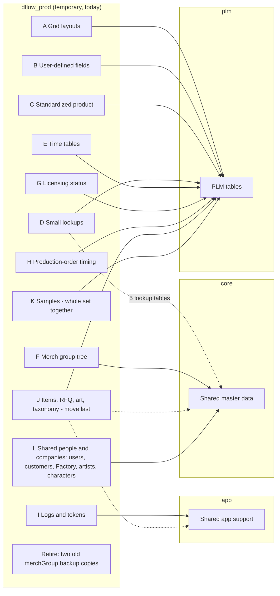

# DesignFlow production: which tables can move together (2026-11-05)

Source: live read-only catalog read of production `dflow_prod` foreign keys
(`qsllyeztdwjgirsysgai`, 2026-11-05), plus each table's permanent home in `plm` / `core` / `app`.
Re-derive before acting. Foreign keys only catch database-declared links. Many legacy
DesignFlow tables are joined in app code with no foreign key, so the groups below
add the business-area links too.

## The plan at a glance

Order: A to I can each move on its own, easiest first. Then J, K and L. Nothing stays in `dflow_prod`; the schema is deleted at the end.

## Recheck 2026-11-25

Re-read production foreign keys and the four services' `develop` code on 2026-11-25. Changes: the J2 row and two lookups (embellishment_phrase, ContainerHeader) added; externalCustomer is gone from production and removed. New finding: group J tables (art_piece, art_types, artist_types, age_group, RolePermissions, user_roles, item_user_assignment, item_workflow_action) point at `users`, which is group L. Moving J before L leaves foreign keys across schemas; Postgres allows that, but the L reshaping (#4705–#4710) must keep the user ids those keys use. The four services' table maps are not identical today, so per-table placement is safe only once all four carry the same entry for each moved group.

## How a partial move works

The DesignFlow services already decide each table's schema separately (`config/table-schema-map.js`).
Production forces everything into one schema today. A partial move means turning on
per-table placement in production, keeping `dflow_prod` as the default, and listing
only the moved group. Every service that reads a table must ship the same map entry.

## Groups, easiest first

Each destination is the existing same-name table in that schema, as listed in
`designflow-master-data-migration/designflow-schema-segregation.md`.

| # | Group | Moves to | Tables | Notes |
|---|---|---|---|---|
| A | Grid layouts | `plm` | GridAccessLevel, GridChildrenLayout, GridChildrenLayoutOrder, GridLayout, GridViewState, grid_cell_notes | No links out |
| B | User-defined fields | `plm` | UDFComponent, UDFElement, UDFElementType, UDFGroup, UDFQuery, UDFTable | No links out |
| C | Standardized product | `plm` | StandardizedDetail, StandardizedGroup, StandardizedProductElement, StandardizedProductElementValue, StandardizedProductType, StandardizedSize, StandardizedVendor, StandardizedVersion | No links out |
| D | Small lookups | `plm`, except product_category, merchGroupHeaders, vendorGroup, externalVendor → `core` | FOBCountry, ShippingPort, ProdPaymentTerms, ProdShipmentTransitTime, deliveryLocation, externalApi, ProductNickname, itemSize, itemDepth, itemType, product_category, merchGroupHeaders, vendorGroup, externalVendor, embellishment_phrase, ContainerHeader | Reference lists |
| E | Time tables | `plm` | DesignTeamTime(s), FactoryTimes, LicensingTime(s), OrderLeadTime, LicenseFeedBacks, licensingMilestone | Reference lists |
| F | Merch group tree | `core` | merchGroupMaster, merchGroupRelations | Linked to each other |
| G | Licensing status | `plm` | licensingStatus, groups, licensingFeedbackReply | Linked to each other |
| H | Production-order timing | `plm` | ProdOrderHeader, FactoryTime, prod_order_milestone_schedule, product_type_factory_time | Linked. ProdOrderDetail is in group J |
| I | Logs and tokens | `app` | AuditLog, email_logs, ai_cache_events, auth_token, quote_auth_token, app_settings, AdditionalUserEmail | Tokens and extra emails belong to users, so move them only after a check that nothing joins them to users |
| J | Items, RFQ, art, taxonomy (linked) | `plm` for items, RFQ, art, orders, division/company/season codes, item_customer_selling (new); `core` for licenseList, merchGroup, age_group, art_types, artist_types, vendor, property_character_associations, vendor_wechat_identity (new); `app` for RolePermissions, UIElements, user_notification, Roles → app.role, user_roles → app.user_role, comments → app.comment | itemHeader, RFQItem, item_* links, art_piece(_attachment), artist_types, art_types, licenseList, merchGroup, age_group, vendor, divisionCode, companyCode, SeasonCode, RFQStep, ProdOrderDetail, Roles, user_roles, RolePermissions, UIElements, user_notification, comments | Holds three of the four blocked tables. Move after A–I |
| K | Samples | `plm` (about 20 new tables needed) | every sample_* table | Owner ruling: samples move together, in one step |
| L | Shared people and companies | `core` (owner ruling: shared core) | users, customers, Factory, artists, properties_and_characters | Legacy shapes differ from the core tables, so each needs reshaping (tracked on #4705–#4710) |
| J+ | Same area, no foreign key | `plm` | itemDetail, itemAttachment, RFQGroup, RFQVendor, RFQContainer, RFQItemDivision, RFQItemStatus, RFQWhse | Joined to items/RFQ in code. Move with J |
| J2 | Product type and descriptions (new since 2026-11-05) | `plm` | product_type, product_type_mg, product_type_mg03_allowed, product_type_request, product_type_search_log, description_convention, item_description_parts, item_product_description(_history), mg_combination_description(_history), mg_display_name, itemLicenseImage, productUserAssignment, merchGroupRepairJournal | Foreign keys tie them to itemHeader and merchGroup. Move with J |

## Nothing stays in `dflow_prod`

The schema is deleted at the end. merchGroup_04112026 was deleted on 2026-11-05 (#5748; backup kept in 1Password). The other old backup copy,
merchGroup_pr90_bad, is archived, then dropped. tracking_grid_archive moves to `plm` (new table).

## Data check still owed for every group

Each permanent home already holds rows (an older copy). For each group, decide whether to
adopt the existing rows or replace them with current production rows before it moves.
